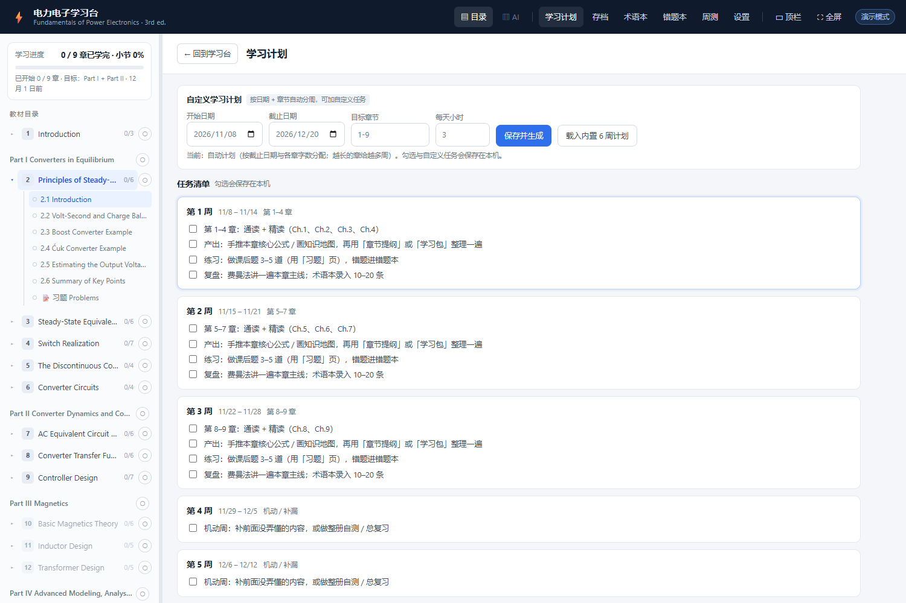
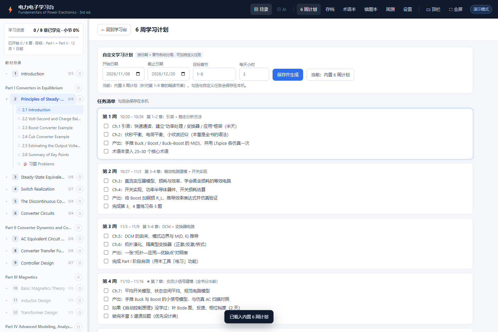

# PowerElectronics Study Desk · 电力电子学习台

> 把 Erickson《Fundamentals of Power Electronics》(3rd ed.) 的英文精读，做成一个本地网页学习工作台：
> **读前预习 → 读中精读 → 读后练习 → 费曼复述 → 章节学习包 → 习题 / 复习计划**，每一步都由你配置的大模型（DeepSeek / OpenAI / Ollama 等）现生成。

[](LICENSE)
[](https://www.python.org/)
[](static/js)

> ⚠️ **版权声明**：本项目只包含工具代码，**不包含、也不分发**教材 PDF 或提取后的教材文本（data/ 已在 .gitignore 中）。你需要自行准备合法获得的 PDF 副本；本工具仅用于个人学习。README 中的截图只用于展示软件界面，其中出现的少量教材片段仅作说明用途。本项目与 Springer / 作者无关联，如权利人认为有不妥请联系删除。



---

## ✨ 功能

| 模块 | 说明 |
| --- | --- |
| 阅读器 | 左「教材页面」（PDF 渲染、缩放、单/双页）+ 右「提取原文」（图表公式以高清图片内嵌） |
| 读前预习 | 零基础引导问题、联动已学小节、逐题解答 |
| 读中精读 | 四栏精读（英文 → 直译 → 术语 → 论证）、公式拆解、术语卡、追问 |
| 读后练习 | 出题（概念/计算/设计）→ 作答 → 严格批改 → 错题本 |
| 费曼法 | 你讲 → AI 扮演初学者追问 → 诊断报告（含评分与下一步） |
| 学习包 | 自选 10 类内容（导图/提纲/结论/推导/自测/仿真/易错/术语…），可导出 Markdown、打印 |
| 习题 | 每章 Problems 独立入口：看原文 + **习题解答（逐题单独保存）/ 习题全解 / 章节提纲 / 费曼** |
| **自定义学习计划** | 按「开始/截止日期 + 目标章节」自动分周；可追加/删除自定义任务；可一键切回内置 6 周计划 |
| 知识锚定 | 高亮 / 查词按**内容哈希**定位，重建教材数据后自动归位，旧标记尽量不丢 |
| 复习资产 | 学习存档、术语本、错题本、周测、学习计划全部本地保存，可一键导出/导入 |
| 自定义提示词 | 设置里可覆盖任意任务的提示词，随时恢复默认 |
| 自动备份 | 修改后自动写 `backups/*.json`（保留 30 份），启动时自动补备份 |
| 构建校验 | `tools/verify_book.py` 检查数据结构、段落/图片、习题切分，构建后自动运行 |

更多截图见 [`docs/screenshots/`](docs/screenshots)。

---

## 🚀 快速开始

### 1. 环境

- Python 3.9+
- 任意 OpenAI 兼容的 API（DeepSeek / OpenAI / 本地 Ollama / vLLM / 硅基流动…）
- Windows 可直接双击 `启动学习台.bat`；macOS / Linux 用 `./start.sh`

```bash
python -m pip install -r requirements.txt
```

### 2. 准备教材 PDF（必须自备）

本项目**不附带** Erickson 教材。把你自己合法获得的 PDF 放到项目根目录并命名为 `book.pdf`：

```
power-electronics-study-desk/
├─ book.pdf              ← 你的 PDF（已在 .gitignore 中）
├─ config.example.json
└─ ...
```

或者：

```bash
cp config.example.json config.json
# 编辑 config.json，把 "pdf" 改成你的 PDF 路径（绝对路径或相对本目录）
```

也可以设置环境变量：`PE_PDF=/path/to/book.pdf`。

### 3. 构建教材数据（首次 1–3 分钟）

```bash
python tools/build_book.py
```

构建结束会自动运行数据校验，输出 `PASS/WARN`。生成的 `data/` 与 `_cache/` 不会进 Git。

### 4. 启动

```bash
python server.py
# 或 Windows: 启动学习台.bat
```

打开 `http://127.0.0.1:8765/`，右上角「设置」里填写 API（Key 只存在本机浏览器，通过本地服务转发）：

| 服务 | Base URL | 模型示例 |
| --- | --- | --- |
| DeepSeek（推荐） | `https://api.deepseek.com/v1` | `deepseek-chat` |
| OpenAI | `https://api.openai.com/v1` | `gpt-4o-mini` |
| 本地 Ollama | `http://localhost:11434/v1` | `qwen2.5:14b` |

没配 Key 可以勾选「演示模式」先预览界面。

---

## 🗓 自定义学习计划（本分享版新增）

侧边栏「学习计划」→ 顶部「自定义学习计划」：

- 设置 **开始日期 / 截止日期 / 目标章节（如 `1-9` 或 `1,3,5`）/ 每天小时数**，点「保存并生成」；
- 自动按各章字数把章节分配到每一周，越长的章给越多时间；
- 可在任意周 **添加自定义任务**（例如「整理第 1 章术语 20 条」），也可单独删除；
- 想回到作者推荐的节奏，点「载入内置 6 周计划」；
- 所有勾选、自定义任务、日期设置都会保存到本机，并包含在备份/导出里。



---

## 🧭 使用流程建议

1. **预习**：先看 5 个零基础问题，自己想 30 秒；
2. **精读**：左边看原版页面 / 提取原文，选中文字 → 🖍高亮 / ⚡查词 / 四栏精读；
3. **练习**：出 3 道概念/计算/设计题，作答后让 AI 严格批改，错题进错题本；
4. **费曼**：合上书讲一遍，让 AI 扮演初学者追问，最后看诊断报告；
5. **学习包 / 章节提纲**：每章结束生成一份，串成知识地图；
6. **习题**：章末 Problems 里逐题看解答，或生成整章全解；
7. **复习**：学习计划 + 错题本 + 术语本 + 周测。

---

## 📂 目录结构

```
power-electronics-study-desk/
├─ server.py                 # 本地服务：静态页 + 教材数据 + AI SSE 代理
├─ 启动学习台.bat / start.sh
├─ config.example.json       # PDF 路径示例（复制为 config.json）
├─ requirements.txt
├─ static/
│  ├─ index.html  style.css
│  ├─ content/prompts.txt    # 内置提示词（可在网页里覆盖）
│  ├─ js/{core,prompts,api,views,app}.js
│  └─ vendor/                # marked + KaTeX（离线可用）
├─ tools/
│  ├─ build_book.py          # PDF → data/（章节、文本、图表块、习题）
│  ├─ verify_book.py         # 构建数据校验（构建后自动跑）
│  └─ mock_llm.py            # 本地假接口，离线验证链路
├─ docs/screenshots/         # 截图
└─ data/  _cache/  backups/  # 运行时生成（已 gitignore）
```

### 数据流

```
教材 PDF ──build_book.py──▶ data/book.json + data/sections/*.json
                              │（每节: text/paras/items，图片按页坐标裁剪）
浏览器 ──/api/*──▶ server.py ─┘
浏览器 ──/api/chat──▶ 你的 OpenAI 兼容接口（SSE 流式）
```

---

## 🧩 技术要点

- **零构建前端**：原生 JS + marked + KaTeX（vendored），无需 npm；
- **PDF 解析**：PyMuPDF 读取大纲、段落、字体与矢量图元；按小节标题截取，图表/公式按坐标裁剪为图片；
- **长文本**：学习包/章节提纲超过 2.4 万字符时自动「分块提炼 → 合并」，不再因输入截断而残缺；输出达到模型上限时自动续写；
- **高亮锚定**：每条高亮保存段落内容哈希，数据重建后按内容找回原段落；
- **隐私**：API Key、学习数据只在本机；仓库不包含任何个人或教材数据。

---

## 🧪 开发与校验

```bash
# 数据结构校验（构建后会自动执行）
python tools/verify_book.py

# 语法检查
python -m py_compile server.py tools/build_book.py tools/verify_book.py tools/mock_llm.py
for f in static/js/*.js; do node --check "$f"; done
```

`tools/mock_llm.py` 可在本地 8790 端口模拟 OpenAI 兼容流式接口，用于无 Key 测试链路。

---

## ⚠️ 已知限制

- 需要**文字版 PDF**（扫描件无文字层时不支持，需先 OCR）；
- 图表按矢量图元聚类裁剪，纯栅格图/扫描图效果有限；
- 本书 PDF 为单栏排版；双栏/复杂版式需要调整 `tools/build_book.py` 中的版面参数；
- 学习包/章节提纲对超长内容会多次调用模型，更完整但更慢、更耗 token；
- 只在 Windows + Chrome 上做过完整测试，其他平台理论上可用但未全面验证。

---

## 🤝 贡献

欢迎 Issue / PR。请勿提交教材 PDF、`data/`、API Key 或个人学习数据（见 `.gitignore`）。详见 [CONTRIBUTING.md](CONTRIBUTING.md)。

## 📄 License

[MIT](LICENSE)。代码可自由使用、修改、分发，请保留版权声明。

## 🙏 致谢

- Robert W. Erickson & Dragan Maksimović, *Fundamentals of Power Electronics* (3rd ed.) —— 本工具的学习对象（本项目不包含其内容）；
- [PyMuPDF](https://pymupdf.readthedocs.io/) / [marked](https://marked.js.org/) / [KaTeX](https://katex.org/)。

---

## English

A local web study desk for *Fundamentals of Power Electronics* (3rd ed.): PDF reader with extracted text/figures, AI-powered pre-reading, close reading, practice, Feynman review, chapter study packs, problem solving, and a customizable study plan. Bring your own copy of the book (PDF not included). Built with Python + vanilla JS; runs fully locally, and your API key never leaves your machine.

```bash
pip install -r requirements.txt
# put your PDF as book.pdf (or edit config.json)
python tools/build_book.py
python server.py
```
